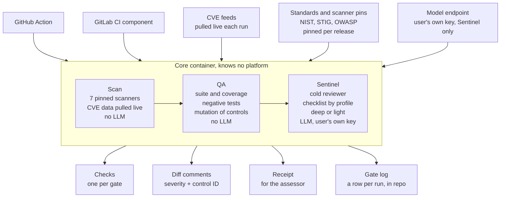

# Secure Builder Bot — PRD

2026-10-14 · the maintainer

## Summary

Secure Builder Bot is one open-source bot that puts three gates on every pull request: a **Scan** gate (seven pinned scanners, CVE-fresh), a **QA** gate (tests prove the code, including mutation of every declared security control), and a **Sentinel** gate (a cold AI reviewer running a NIST 800-53 checklist on the diff). A team installs it on GitHub or GitLab, picks a compliance profile (IL4 or IL6), picks which gates to turn on, and has every one of them running on their next pull request. No other setup.

The promise: **install it, choose Moderate or High, open a PR, see the verdict.** Everything the bot checks against (NIST 800-53 Rev 5, DISA STIGs, OWASP Top 10, CVE databases, scanner versions) refreshes on its own, so the first install is the last time anyone thinks about it.

It is for small teams building software that has to pass an authority to operate, and for anyone who wants that level of rigor without a compliance department. The engine behind it has gated roughly 200 tickets across 20 merged epics on one production project. This PRD describes extracting that engine into a bot anyone can use, with no reference to the platform it grew up on.

## Goals and non-goals

**Goals**

1. **Ten minutes from install to first verdict.** A new user installs the app, answers three questions, and the next PR gets all three gates. No YAML authoring, no scanner setup, no model keys unless they turn Sentinel on.
2. **Three gates, each independently switchable.** Scan alone, Scan plus QA, or all three. Turning one off never breaks another.
3. **IL4 and IL6 as first-class profiles.** Picking a profile sets the NIST 800-53 Rev 5 baseline (Moderate or High), the STIG set, and the extra checklist blocks. Nothing else to configure.
4. **Nothing goes stale.** Standards, scanner versions and vulnerability feeds update on a schedule the user never has to touch, with a record of what changed and when.
5. **Same behavior on GitHub and GitLab.** One core, two thin adapters, identical verdicts.
6. **Every verdict is auditable.** Each run leaves a receipt a human can hand to an assessor: what was checked, against which version of which standard, and what it found.
7. **No platform fingerprints.** Nothing in the bot names or assumes any specific hosting platform, pipeline vendor or organization.

**Non-goals**

- Not a merge bot. It reports a verdict. A human merges.
- Not a code generator. It never writes fixes to the user's branch.
- Not a hosted SaaS in v1. It runs in the user's own CI. A hosted option is a later decision.
- Not a replacement for an assessor. It produces evidence. It does not grant an authority to operate.
- Not a scanner itself. It orchestrates existing scanners and keeps them current.

## The install experience

The whole product rests on this section. A user should get everything running without reading documentation.

**GitHub, the default path**

1. Click **Install** on the GitHub Marketplace listing. Choose the repositories.
2. The bot opens one pull request on each chosen repo titled "Enable Secure Builder". The PR adds a single file, `.securebuilderbot.yml`, with three questions answered by defaults and a comment above each explaining the choice.
3. The user edits the three answers if they want, then merges that PR. From the next PR onward, every gate they turned on runs.

The three questions:

| Question | Options | Default |
| --- | --- | --- |
| Which compliance profile? | `il4` (NIST 800-53 Moderate), `il6` (High), `none` (OWASP only) | `il4` |
| Which gates? | `scan`, `qa`, `sentinel`, any combination | `scan` and `qa` |
| Where does Sentinel run? | `action` (in CI, user's model key), `self-hosted` (user's own runner), `off` | `off` until a key is added |

**GitLab, the same three questions**

GitLab has no marketplace app model with the same reach, so the install is one line in `.gitlab-ci.yml` that includes the Secure Builder CI component, plus the same `.securebuilderbot.yml`. The bot's setup command writes both.

**The one-command alternative for either platform**

```
npx securebuilderbot init
```

Runs locally, detects GitHub or GitLab from the remote, asks the three questions in the terminal, writes the files, opens the PR. For people who would rather not click through a marketplace.

**Three implementation options, chosen at install and changeable later**

- **Light.** Scan gate only. No test suite required, no model key. Every repo qualifies on day one. This is the free, zero-friction entry.
- **Standard.** Scan and QA. Requires a test suite the bot can run and a control manifest, which the bot drafts on first run from the code it finds (auth middleware, scope filters, role checks) and asks the user to confirm.
- **Full.** All three gates. Requires a model API key stored as a CI secret. Sentinel reviews every PR classified deep; light PRs (docs, config, no production code) skip the expensive half automatically.

**What the user never does**

- Install or pin a scanner. The bot ships with all seven and updates them.
- Download a standard. NIST, STIG and OWASP indexes ship inside the bot and refresh on their own.
- Write a checklist. The profile selects it.
- Configure thresholds. Sensible defaults per profile, overridable in the one file for those who want to.

## The three gates

Each gate is a separate job with its own pass/fail check on the PR. A gate that is off is simply absent, not skipped-green. The gates run in order because each one earns the trust the next one spends: Sentinel reads the control manifest and believes it only because QA just proved every control has a test that breaks.

| Gate | Question it answers | Needs from the user | Needs an LLM | Typical cost per PR | Runtime |
| --- | --- | --- | --- | --- | --- |
| **Scan** | Is anything in this tree known-bad? | Nothing | No | Cents | 3 to 8 min |
| **QA** | Do the tests prove the code, including the security controls? | A runnable test suite; a control manifest (drafted for them) | No | Cents to a dollar | 5 to 20 min |
| **Sentinel** | Does the code keep every user in their lane, against the chosen baseline? | A model API key | Yes | $2 to $15 on a deep PR; near zero on a light one | 5 to 15 min |

**Scan gate**

Seven scanners, each pinned to a version the bot controls and updates. Hadolint (Dockerfiles), Checkov (infrastructure as code), ClamAV (malware), Grype and Trivy (dependency and image CVEs, two engines because their databases disagree), the ecosystem's native audit (npm audit, pip-audit, cargo audit, govulncheck), and the ecosystem's linter with its security ruleset. Each scanner writes a receipt: version, database date, findings, exit code. A single verdict line combines them. Any critical or high CVE without an accepted-risk entry fails the gate.

**QA gate**

Five checks, all mechanical, all from scripts that exist today:

1. The suite runs green, with no skipped tests added without a ticket reference.
2. Coverage on the changed lines meets the profile's threshold.
3. Every new or changed route has a negative test: unauthenticated request rejected, user A cannot reach user B's record.
4. No mocked database on an integration path.
5. **Mutation of controls.** For each row in the control manifest, the bot disables that control in a temporary copy, runs the suite, and requires red. A control that survives is a blocking finding. This is the check that makes Sentinel's input trustworthy.

**Sentinel gate**

A cold reviewer with no build context. It reads the diff, the manifest, and the profile's checklist, and produces a verdict with a citation or an N/A reason for every item. Two depths, chosen automatically by what the diff touches:

- **Light** (docs, config, tests only, no production code): checklist and scan verdict only. Fast and nearly free.
- **Deep** (production code, especially anything control-shaped): adds the Control Completeness review, six questions per touched control, then an adversarial review and an edge-case hunt against the diff.

Sentinel never merges and never edits the branch. It posts findings as review comments with a severity, and the verdict as a check. A blocking finding fails the check. The reviewer's own regression test, the proof set, is a list of real bugs past runs caught; any change to the reviewer must still catch every one.

**Switching**

The `gates` line in the config. Turning Sentinel off removes the check from the PR and stops the API spend. Turning QA off leaves Scan untouched. Turning Scan off is allowed but the setup PR warns against it.

## Compliance profiles

A profile is one word in the config that selects a baseline, a STIG set, checklist blocks and thresholds together. The user picks the impact level their system is accredited at and the bot does the mapping.

|  | `none` | `il4` | `il6` |
| --- | --- | --- | --- |
| NIST 800-53 Rev 5 baseline | not applied | **Moderate** | **High** |
| Control count in baseline | 0 | 287 | 370 |
| OWASP Top 10 | yes | yes | yes |
| DISA STIGs | none | Application Security and Development STIG; container and web server STIGs where the repo has them | IL4 set plus the database and OS STIGs, every CAT I enforced |
| Sentinel checklist blocks | base | base + Moderate | base + Moderate + High (cross-domain, session lock, non-repudiation, covert channel) |
| Scan: fails on | critical CVE | critical or high CVE | critical, high, or any CVE older than 30 days at medium |
| QA: coverage on changed lines | 60% | 80% | 90% |
| QA: mutation of controls | optional | required | required |
| Accepted-risk entries expire after | never | 180 days | 90 days |

**How a profile is checked, not just named**

Every item in the Sentinel checklist carries the control ID it serves, like `AC-3` or `SC-8`, and the bot ships an index of the full 800-53 Rev 5 catalog with each baseline's membership. At gate time the bot derives the checklist from the baseline, so a control in the High baseline that no checklist item cites shows up as a gap in the receipt, not as silently unchecked. Citations are verified mechanically on every run: an ID that does not exist in the current catalog version fails the self-check.

STIG findings work the same way. Each STIG rule the bot can test mechanically (banner text, TLS version, logging fields, password policy in config) becomes a Scan-gate check tagged with its rule ID and CAT level. Rules that need judgment become Sentinel checklist items. Rules that neither can test are listed in the receipt as "not assessed by this tool" so the assessor knows exactly where the bot stops.

**What a profile does not do**

It does not prove the system meets the baseline. Most 800-53 controls are organizational (policy, training, physical access) and no code scanner can speak to them. The receipt names which technical controls the bot assessed and leaves the rest to the user's system security plan. Overclaiming here is the fastest way to lose an assessor's trust, so the receipt is conservative by design.

**Custom profiles**

A team with a tailored baseline can write `profile: custom` and list control IDs to add or remove. Rare, and deliberately a little harder than picking a word.

## Staying current

Two kinds of thing go stale, and they update on different clocks. Vulnerability data changes hourly and is pulled at run time. Standards and scanner versions change monthly or yearly and are shipped as bot releases, so a user's gate behavior only changes when they take a release.

| What | Source | How often it changes | How the bot refreshes it | What the user sees |
| --- | --- | --- | --- | --- |
| CVE databases (Grype, Trivy) | Each scanner's own feed, fed by NVD and vendor advisories | Hourly | Pulled fresh at the start of every Scan run; receipt records the database timestamp | A PR that was green yesterday can go red today, with the new CVE named |
| Ecosystem audits (npm, pip, cargo, go) | The registry's advisory database | Hourly | Live at run time, same as above | Same |
| Scanner binaries (all seven) | Upstream releases | Weekly to monthly | A bot workflow checks upstream weekly, pins the new version, runs the proof set, opens a release PR on the bot's own repo | A new bot release; the setup PR on their repo bumps the version with a changelog line |
| NIST 800-53 Rev 5 catalog and baselines | NIST OSCAL JSON | Rarely, with errata | Same weekly workflow diffs the OSCAL; a change regenerates the index and the citation check | A release note naming controls added, withdrawn or renamed |
| DISA STIGs | DISA's public XCCDF benchmark downloads | Quarterly | Same workflow; a new benchmark version regenerates the rule index and flags checklist items whose rule IDs moved | A release note listing rule changes and any checklist item that needs rewording |
| OWASP Top 10 and ASVS | OWASP's published lists | Every 3 to 4 years | Manual, on publication; it is small enough to review by hand | A release |
| Sentinel checklist and skills | The bot's own repo | With each finding that becomes a check | Governance: every change is its own commit, proof set must still pass | Release notes |

**The weekly refresh workflow, in the bot's repo only**

1. Fetch each upstream (scanner release pages, NIST OSCAL, DISA benchmarks).
2. Diff against what is vendored.
3. If anything changed: regenerate the index, run the bot's own self-tests and the proof set against the pinned fixtures, and open a PR with the diff summarized.
4. A maintainer merges. A release is cut. Users on `version: latest` get it on their next run; users pinned to a version get a notice in their next PR check.

The bot never schedules anything in the user's repository. The scheduled work happens once, in the bot's own repo, and ships as a release. This keeps the user's CI quiet and makes every behavior change traceable to a version number.

**Freshness is itself a check**

Every receipt carries the versions of all seven scanners, the date of each CVE database, and the version of each standard index. If any is older than the profile allows (30 days for CVE data at IL6, 90 at IL4), the Scan gate fails with a one-line reason: stale data is not a pass.

## Configuration

One file at the repo root. The setup PR writes it with every line commented. A user who never opens it still gets a working install.

```yaml
# .securebuilderbot.yml
profile: il4            # none | il4 | il6 | custom
gates: [scan, qa]       # any of scan, qa, sentinel
version: latest         # or a pinned release, e.g. 1.4.2

# Everything below is optional. Defaults come from the profile.
sentinel:
  provider: anthropic   # anthropic | openai | self-hosted
  key_secret: SB_MODEL_KEY   # name of the CI secret, never the value
  depth: auto           # auto | always-deep | always-light

qa:
  test_command: auto    # auto-detected from package.json, pyproject, go.mod, build.gradle
  manifest: docs/security/CONTROL-MANIFEST.md

scan:
  accepted_risks: docs/security/accepted-risks.yml   # CVE IDs with reason and expiry
  skip: []              # scanner names to skip, each needs a reason in a comment
```

**Rules the file follows**

- Three lines are enough. Everything else has a default the profile sets.
- No secret values ever appear in it. Only the names of CI secrets.
- Disabling anything the profile requires (mutation at IL4, a scanner at IL6) is allowed but shows as a yellow note on every PR check until it is re-enabled. The user is never blocked from their own repo, and never allowed to forget.
- The file is validated on every run. An unknown key or a bad value fails fast with the line number.
- The copy on the target branch's tip governs a pull request, and so do the target's accepted-risks file, Checkov justifications, npm-audit allowlist and `.constraintsignore`. Never the merge base: a pull request could choose that by branching from an older commit. A pull request cannot loosen its own gate: what it changes is validated, reported on the run, and applies once it is merged. Only the adoption pull request, whose target has no config yet, runs under its own copy (Sentinel runs once the config is merged).
- The workflow file that runs the bot lives in the repository, so a pull request can edit it. The bot reports a range that changes it, but the guarantee holds only when the workflow is enforced from outside the pull request: a GitHub ruleset that requires the workflow and its checks, or a GitLab pipeline execution policy. GitHub counts a neutral (yellow) check as passing a required check.
- On GitHub a pull request retargeted at another branch is gated again, against that branch's tip as fetched by the job: one run per pull request survives (an older run is cancelled, and a title or body edit cancels nothing), and the publisher posts nothing when the pull request's live base is not the branch the run gated against, so a re-run of a job from before the retarget cannot post. GitLab starts no pipeline when only the target branch changes: run the merge request's pipeline again after retargeting it. A GitLab merge request from a fork is refused unless its pipeline runs in the parent project, because in the fork the target branch would be the fork's own.
- The pull request's code runs in a job of its own. Scan and QA run it (the scanners load its build scripts and configs, QA runs its tests), so the workflow the setup writes runs them as core's untrusted part, in a job with read access only, no secret and no write token. Sentinel and the verdict run in a second job (core's trusted part), which reads the pull request's checkout as data and never imports or runs anything from it: core's launcher drops the checkout from Python's module path. That job holds the model key, and on GitHub the token that posts checks and comments; on GitLab a third job holds the token and only publishes. The verdict job reads the first job's run as data from another job: size-capped, checked field by field against the shape core writes, refused unless it gated this head and merge base, every string folded to one redacted line, keys core never writes dropped, never executed; only Scan and QA results are taken from it. So a pull request's *tests and build scripts* can no longer read the model key, post checks or comments, change Sentinel's result or its section of a check, or touch the install that publishes. What they can still do, stated so nobody relies on more: forge the Scan and QA results of their own job, since that job ran them. So every Scan and QA check, and the receipt, says the status is that job's claim, and the controls those gates would assess (SA-11 for the mutation of controls, RA-5 for the scan) are listed as claimed, not assessed, by the run that publishes; Sentinel, told that QA did not run in its job, treats every manifest row as unproven. A sabotage-tested control is proven only as far as the pull request's own tests are honest; a reviewer reading the diff is what catches tests written to game it. The separation holds under three conditions the bot cannot enforce from inside the repository. The workflow that runs must be the target branch's: anyone who can push a branch can add a workflow of their own, and on GitHub repository secrets reach any workflow a same-repository pull request runs, so require the bot's workflow from outside the pull request (a ruleset) and treat push access as access to the key (a fork's pull request gets no secrets at all). On GitLab an environment scope is not access control until the environment is protected, so both `secure-builder` and `secure-builder-sentinel` must be protected environments. And the jobs must not share a machine: GitHub's hosted runners are fresh per job; a self-hosted runner, or a GitLab shell executor or reused build volume, must be ephemeral, or what the gates job leaves behind is there when the verdict job runs. Run in one job (the action with no `part`), the gates share that job as before, and the receipt says `part: whole`. The workflow is reported when it changes under .github/workflows, .github/actions, .gitlab-ci.yml or .gitlab, but not when it pulls in a local action or include from elsewhere. And checkov's own inline `checkov:skip` annotations in the pull request's files still suppress a finding, by design: they are in the diff a reviewer reads.

**The control manifest**

The QA gate needs to know which functions are security controls. The bot drafts the list from the code: one row per function that refuses access (a 403 or 404 refusal, a role check), and one row marked "suggested, check me" per function whose name says it protects something without refusing (redact, mask, sanitize; verify, authenticate; rate limit, throttle; error handlers; require, ensure, assert, can, scope; logger, audit), each with the test file it thinks proves it. It reads TypeScript in a web app's middleware, services and controllers folders under backend/src unless `project.config.yaml` names other directories with `CONTROL_SRC_ROOTS` (and `CONTROL_SRC_EXT: py` for Python). When nothing names them and none of those three folders exists, `securebuilderbot init` and QA's drafted mode infer them from the layout: in a repository with `pyproject.toml`, `setup.py` or `requirements.txt` and no `package.json`, every top-level directory holding `__init__.py` plus `src`, `app`, `server` and `lib`, never tests, docs, a virtualenv or a hidden directory, with tests in `tests` or `test` run by `python3 -m pytest -q -x`; otherwise TypeScript and JavaScript under `src`, `server`, `lib`, `app` and `backend/src`, with tests in `test`, `tests` or `__tests__` run by `npm test --silent` when `package.json` names a test script. Its log in QA's evidence names the directories it read, and says when they were inferred. `securebuilderbot init` puts the draft in the setup pull request when QA is on and the repository has no list. When the draft came from inferred directories, the pull request also carries a new `project.config.yaml` naming them (`CONTROL_SRC_ROOTS`, `CONTROL_SRC_EXT`, and `CONTROL_TEST_DIR` and `CONTROL_TEST_CMD` when they were found), and init says so; a `project.config.yaml` the repository already keeps is never overwritten, and init prints the lines to add to it instead. The user deletes the rows that are not controls, adds any the draft missed, and merges. From then on the manifest is theirs, and QA fails when a new function that refuses access appears with no row.

While the target branch's list has no rows (no list, or only its header) and the pull request adds none, QA drafts the list on every run and sabotage-tests the first 20 drafted controls, so the check has teeth from the first pull request. The result is yellow, never green, and names how many drafted controls were tested and caught; a drafted control the suite survives is named but does not block, because nobody has confirmed it is a control. With nothing to draft, or with mutation off in the config, QA is still yellow and says so. Only this drafted mode infers directories; a declared list reads `project.config.yaml` alone. When it inferred them and the suite command it inferred is red before any mutation, or none could be inferred, nothing is sabotage-tested and QA is yellow, naming the command and the `CONTROL_TEST_CMD` key to set, never a check that could not run. A pull request whose head commit has no rows while the target branch's list has some fails, with a message that says whether the branch removed them or was cut before the list existed and must merge it in. The lists are read from git (at the target branch, the branch point and the head commit) before any of the pull request's code runs, and the control tools are handed that copy of the head commit's list, never the file in the checkout, which the pull request's own tests could rewrite. A list that cannot be read, or is a link, stops the check rather than counting as none. GitHub shows yellow as a neutral check, which a required check accepts, so yellow is a warning on the pull request, not a block.

## Platforms

One core, two adapters. The core is a container image that takes a checkout, a base ref, a head ref and the config file, and produces receipts plus a verdict. It has no idea which platform called it. The adapter's job is to get the checkout in and the verdict out in the platform's native shape.

|  | GitHub | GitLab |
| --- | --- | --- |
| Install surface | Marketplace app, or `npx securebuilderbot init` | `include:` of the CI component, or `npx securebuilderbot init` |
| How the core runs | A GitHub Action in the user's workflow, using the user's runner minutes | A CI job from the component, using the user's runners |
| Verdict surface | One check run per gate, with the summary in the check's details | One pipeline job per gate, with a merge request report widget |
| Findings surface | Review comments on the diff lines, severity-tagged | Merge request discussions on the diff lines |
| Receipts | Workflow artifact, 90-day retention by default | Job artifact, same |
| Secrets | Repository or organization secrets | CI/CD variables, masked and protected |
| Self-hosted or air-gapped | Self-hosted runner with the image pre-pulled; feed mirrors configured by URL | Same; GitLab's own container registry can mirror the image |

**Why an Action and a CI component, not a hosted service, in v1**

The users this is for mostly cannot send source code to a third-party service. Running in their own CI means the code never leaves their account, the model key is theirs, and the bot's operator holds nothing. It also means there is no infrastructure to run, which is what makes open source viable for one maintainer. A hosted option, if it ever exists, is a second product and a later decision.

**Air-gapped installs**

IL6 environments often have no outbound internet. The bot supports this by letting every upstream (scanner databases, standard indexes, the model endpoint) be pointed at a mirror by URL in the config. The weekly refresh then runs on the connected side and the mirror is synced by whatever process the environment already uses. The receipt records the mirror's database date, and the staleness check still applies.

## What the user sees

**On the pull request.** One check per enabled gate: `Secure Builder / Scan`, `Secure Builder / QA`, `Secure Builder / Sentinel`. Each is green, red, or yellow (passed with an accepted risk or a disabled default). The check's detail page holds the verdict block: what ran, which versions, what it found, and the one line that says why it failed if it did.

**On the diff.** Findings land as review comments on the lines they concern. Each carries a severity, the control or rule ID it serves, and one sentence on what would fix it. Sentinel's comments are marked as from a cold reviewer so the author knows they carry no build context. Blocking findings and advisory findings are visually distinct, and only blocking ones fail the check.

**The receipt.** A single file per run, attached as an artifact, written for an assessor rather than a developer:

- Profile and baseline, with the catalog version.
- Each scanner: version, database date, findings count, exit code.
- Each QA check: result, with the mutation table (control ID, test file, red or green).
- Each checklist item: cited, or N/A with the reason.
- Controls in the baseline the bot did not assess, listed so nothing is implied.
- Accepted risks that applied, with their expiry dates.

**The gate log.** The bot appends one row per run to a Markdown table in the repo, on the branch, so the history of every gate travels with the code and survives platform migration. Date, range, gate, findings, verdict. It is a tracker, never a blocker: a missing or malformed log never fails a run.

**Noise budget.** A PR that changes only docs gets one check, Scan, and it finishes in under a minute. A deep PR gets all three. The bot never posts a comment that repeats one it already posted on the same line, and resolves its own comments when the next push fixes them.

## Architecture



The adapters hand the core a checkout and get back files. The core runs the three gates in order and stops at the first red. Only Sentinel reaches the model endpoint, with the user's own key. Everything the core produces is a file the platform adapter publishes, so a platform migration loses nothing.

**Packages in the bot's repo**

| Package | What it holds | Language |
| --- | --- | --- |
| `core` | The gate runner, the receipt writer, the verdict logic, the classify step | Bash and Python, as the scripts are today |
| `scanners` | Pins, wrappers and receipt format for each of the seven scanners | Dockerfile and shell |
| `standards` | Vendored NIST OSCAL, STIG XCCDF, OWASP; the index builders; the citation verifier | Python |
| `qa` | Coverage, negative-test detection, control derivation, mutation harness, per-ecosystem adapters | Python, with one adapter per test runner |
| `sentinel` | The gate agent definition, the checklist, the Control Completeness questions, the adversarial and edge-case skills, the proof set replay | Markdown and Python |
| `adapter-github` | The Action, the setup PR generator, the check and comment publisher | TypeScript |
| `adapter-gitlab` | The CI component, the same publisher for merge requests | YAML and TypeScript |
| `cli` | `securebuilderbot init`, `securebuilderbot run` for local use | TypeScript |

**Where the LLM sits.** Only in `sentinel`, behind a provider interface with three implementations: Anthropic, OpenAI-compatible, and a self-hosted endpoint for air-gapped installs. The provider gets the diff, the manifest, the checklist and the profile, and returns structured findings. It never gets credentials, environment files, or anything outside the diff and the files the checklist names.

**Per-ecosystem QA adapters.** The QA gate is the one part that depends on the user's stack. Each adapter knows how to run the suite, read coverage, find route definitions and insert a mutation. v1 ships Node (Jest, Vitest) and Python (pytest). Go, Java and Kotlin follow by contribution or demand.

## Security of the bot itself

A tool that reads every PR on a repo is a target. These are the rules the bot holds to, and each one is checked by the bot's own gate before a release.

- **Least permission.** The GitHub app asks for read on contents and metadata, write on checks and pull request comments. Nothing else. It cannot push, cannot merge, cannot read secrets, cannot change settings. The GitLab component inherits the job token's scope and asks for nothing beyond it.
- **No code leaves the user's CI.** Scan and QA are fully local. Sentinel sends the diff and the named files to the model endpoint the user configured, and nothing else: no environment files, no values files, no lockfile contents beyond package names and versions. The receipt lists exactly which files were sent.
- **Secrets are names, never values.** The config file holds the name of a CI secret. The bot reads the value at run time from the CI environment and never writes it to a log, a receipt, a comment or an artifact. A secrets scan runs on the bot's own output before it is published.
- **Supply chain.** Every scanner is pinned by digest, not tag. The bot's image is built reproducibly, signed, and published with an SBOM. The weekly refresh that bumps a pin runs the proof set before the bump can merge.
- **The bot gates itself.** Every PR to the bot's repo runs all three gates at the `il6` profile. A release that would fail its own gate does not ship.
- **Prompt injection.** Sentinel treats diff content, commit messages and PR descriptions as data. The agent definition says so explicitly, the provider interface strips anything that looks like an instruction to the reviewer from the inputs, and the proof set includes a PR whose description tries to talk the reviewer into a pass.
- **No telemetry.** The bot sends nothing home. Not usage, not versions, not crash reports. A user who wants to report a bug attaches a receipt by hand.

## Open source

**License: Apache 2.0.** It carries a patent grant, which matters for anything a government program might adopt, and it is what the scanners the bot wraps mostly use. MIT is simpler but offers no patent protection; GPL would stop most of the intended users from touching it.

**Repository: `secure-builder-dev/secure-builder-bot`**, public from the first release, private until then. The first commit is a fresh history, not a fork of anything, so nothing from the engine's past (author emails, internal references, platform names) travels with it.

**What is deliberately not in the repo**

- Any reference to a specific hosting platform, pipeline vendor, government program or unit. The `engine/` directory today has around 120 such references; the port rewrites every one as a generic term or drops it.
- Any real infrastructure value. The bot's own secrets scan refuses the commit.
- Any project built with the engine. Those remain where they are. The bot ships with a small synthetic fixture repo (an Express API with a deliberate set of controls and bugs) used by the proof set and the demo.
- A hosted service, a dashboard, an account system. If those ever exist they are a separate repo.

**Contribution model**

- One maintainer with merge rights at the start. Governance files (`CLAUDE.md`, the gate agent, the checklist, the standards indexes) require that maintainer's review on every change, as they do in the engine today.
- Per-ecosystem QA adapters are the intended contribution surface. A contributor who wants the bot on Go or Java writes the adapter, and the fixture repo gets a Go or Java twin to prove it.
- Checklist items and STIG mappings accept contributions with a citation. The citation verifier runs on the PR; an item citing a control ID that does not exist cannot merge.
- A security policy with a private disclosure address, from day one.

**Credits.** The README names what the engine inherits: the adversarial and edge-case review skills descend from the BMAD method's reviewer personas; the thin-ticket and one-session-per-ticket discipline follows Matt Pocock's published Claude Code workflow; the gate-as-cold-subagent pattern follows Anthropic's own guidance on separating build context from review context. Nothing is claimed as original that was not.

**Why open source and not a product, for this version.** The users who need IL4 and IL6 gates cannot buy a hosted service that sees their code, and will not adopt a closed tool they cannot audit. Open source is the only distribution that reaches them. A paid layer, if one ever makes sense, is the hosted dashboard and the support contract, not the gates. The earlier proposal (Secure Builder Bot: open source or product) covers that fork in more detail; this PRD takes the open-source path.

## Milestones

Each milestone is usable on its own. Nobody waits for v1.0 to get value. Durations are working estimates for one person building with the harness, not commitments.

1. **v0.1, Scan gate on GitHub.** About 3 weeks. The core container with the seven scanners, receipts and the verdict line; the GitHub Action; the setup PR with the three questions; `profile: none` and `il4` for the scan thresholds. Platform references scrubbed. The weekly refresh workflow for scanner pins and CVE staleness. Public release, Apache 2.0.
2. **v0.2, QA gate.** About 4 weeks. Coverage, negative-test detection, control derivation, the drafted manifest PR, and the mutation harness, for Node (Jest and Vitest). The fixture repo and the first proof set.
3. **v0.3, Sentinel gate.** About 4 weeks. The cold reviewer with the Anthropic provider, the base checklist with NIST 800-53 citations, the classify step, Control Completeness, the adversarial and edge-case skills, prompt-injection fixtures in the proof set. `il4` fully wired: Moderate baseline, the Application Security and Development STIG, the citation verifier.
4. **v0.4, GitLab.** About 2 weeks. The CI component and the merge request publisher, proving the core is platform-free. `securebuilderbot init` detects both.
5. **v0.5, IL6 and air gap.** About 3 weeks. High baseline, the extra checklist blocks, the full STIG set with CAT I enforcement, mirror URLs for every upstream, the OpenAI-compatible and self-hosted providers, the STIG and NIST refresh in the weekly workflow.
6. **v0.6, Python.** About 2 weeks. The pytest QA adapter and a Python fixture twin. Proves the adapter interface is real.
7. **v1.0, stable.** When ten repos outside the maintainer's own have run all three gates for a month and the proof set has not regressed. Semantic versioning from here; the config schema freezes.

Roughly five months to v0.6 at the throughput the engine has shown on its first project. The order puts the free, LLM-free gates first so the bot is useful to the widest audience before the expensive part exists.

## Open questions

- [ ] **Ownership.** The engine was built on a government project. Before the first public commit, confirm with an ethics counselor that the extracted, scrubbed bot is yours to release. This is the one item that can stop everything else.
- [ ] **Name.** `securebuilderbot` as the CLI, config file and Action name. The bare `securebuilder` is the local engine project and is never used by the bot. Check the npm, PyPI and GitHub Marketplace namespaces before v0.1.
- [ ] **Default model.** Sentinel at v0.3 ships with one provider. Anthropic first because the agent definition was tuned on it, or OpenAI-compatible first because more users already have a key?
- [ ] **Setup PR versus silent config.** The setup PR is one more thing to merge. Is that friction worth the explicit consent, or should the Action run with defaults and offer the config file only when the user wants to change something?
- [ ] **Control manifest format.** Markdown table as today, or YAML? Markdown is readable in the PR; YAML is easier for the drafter and the verifier.
- [ ] **How much of IL6 to claim.** The High baseline has controls no code tool can assess. The receipt lists them as not assessed. Is a tool that visibly covers a fraction of the baseline a selling point (honest) or a deterrent (looks incomplete)?
- [ ] **Hosted later, or never.** Decide before v1.0 whether the open-core path from the earlier proposal is still on the table, because it changes what the config schema has to allow.
